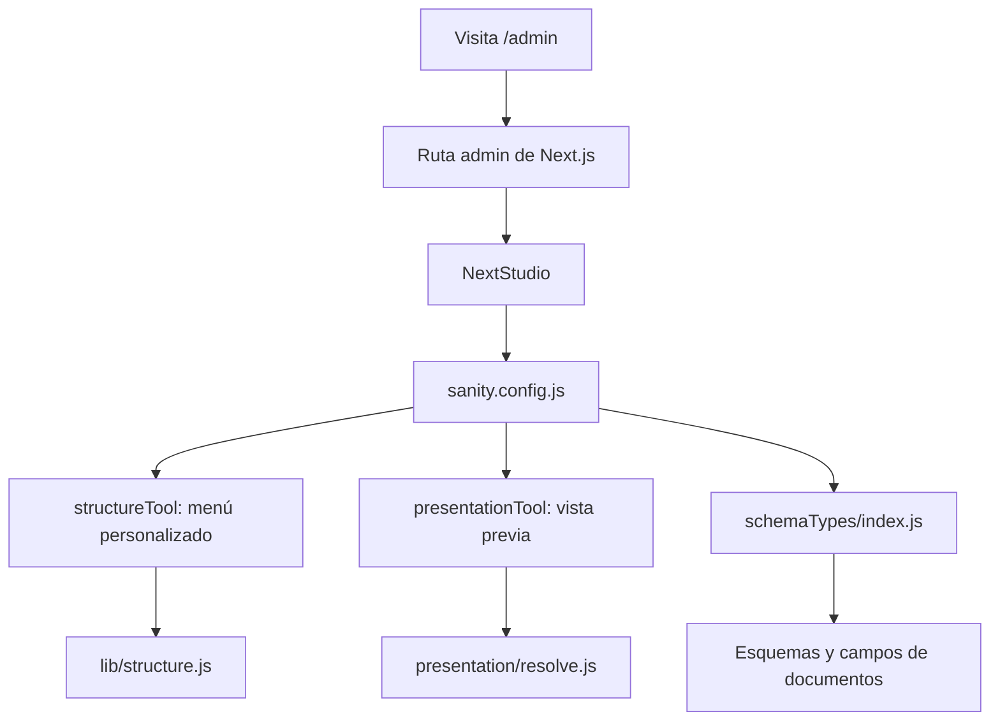
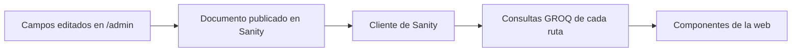

# Guía de `/admin` y revisión de campos de Sanity

**Proyecto:** `Mpinedo04/portafolio-raul`  
**Fecha de revisión:** 15 de noviembre de 2026  
**Alcance:** estructura del panel, esquemas registrados y uso de sus campos en la web.

Esta guía describe cómo está construido el panel de Sanity y compara los campos que aparecen en `/admin` con las consultas y componentes del frontend. “Sin uso actual” significa que el código revisado no lee ni muestra el campo; no significa que el documento de Sanity esté vacío.

## 1. Cómo se monta `/admin`

El panel de Sanity está integrado dentro de Next.js. No es una página independiente:

### Piezas principales

- [`src/app/(admin)/admin/[[...index]]/page.jsx`](../src/app/%28admin%29/admin/%5B%5B...index%5D%5D/page.jsx) renderiza `NextStudio` con la configuración del proyecto.
- [`sanity.config.js`](../sanity.config.js) define el proyecto y dataset, la ruta base `/admin`, los plugins y los tipos de documento disponibles.
- [`src/sanity/lib/structure.js`](../src/sanity/lib/structure.js) construye el menú lateral y decide qué listas o documentos singleton abre cada entrada.
- [`src/sanity/schemaTypes/index.js`](../src/sanity/schemaTypes/index.js) reúne los ocho esquemas registrados.
- [`src/sanity/presentation/resolve.js`](../src/sanity/presentation/resolve.js) conecta cada tipo de documento con una o más rutas públicas para Presentation.
- [`src/sanity/lib/client.js`](../src/sanity/lib/client.js) contiene el cliente de lectura que usa el frontend.

### Menú que se ve en el panel

| Entrada del menú | Tipo de contenido | Cómo lo abre el panel |
|---|---|---|
| `1. INICIO` | `home` | Documento singleton con ID fijo `home`. |
| `2. PROYECTOS (Propios)` | `project` | Lista filtrada por `category == "propio"`. |
| `2. PROYECTOS (Externos)` | `project` | Lista filtrada por `category == "externo"`. |
| `3. SOBRE MÍ` | `about` | Documento singleton con ID fijo `about`. |
| `4. EQUIPO → Inventario Completo` | `equipment` | Lista de documentos; cada equipo es un documento separado. |
| `4. EQUIPO → Estación de Edición (PC)` | `workstation` | Documento singleton con ID fijo `workstation`. |
| `5. ESTUDIOS Y CONOCIMIENTOS` | `studies` | Documento singleton con ID fijo `studies`. |
| `6. CONTACTO` | `contact` | Documento singleton con ID fijo `contact`. |
| `7. GLOBAL (HEADER / FOOTER / SEO)` | `settings` | Documento singleton con ID fijo `settings`. |

Por tanto, hay **seis documentos singleton** (`home`, `about`, `contact`, `studies`, `workstation` y `settings`) y dos tipos de colección (`project` y `equipment`). Las listas de Proyectos Propios y Externos son dos vistas filtradas de la misma colección `project`.

En [`sanity.config.js`](../sanity.config.js), `schema.templates` impide crear documentos nuevos para los tipos singleton. También se limitan las acciones de esos documentos. Esto mantiene una sola instancia de cada sección global.

## 2. Cómo llega el contenido a la web

La web lee el dataset configurado en `client.js`. El cliente actual usa `perspective: 'published'` y `useCdn: true`. Los ajustes globales se agrupan en [`src/sanity/lib/settings.js`](../src/sanity/lib/settings.js); las páginas consultan los documentos de su sección.

La herramienta Presentation está configurada para activar el modo borrador mediante `/api/draft`, y `resolve.js` asigna rutas de vista previa. Sin embargo, el cliente frontend sigue pidiendo la perspectiva publicada. En consecuencia, que el panel abra una vista previa no garantiza que los cambios sin publicar se reflejen en esa página. La vista previa de borradores requiere que el cliente cambie de perspectiva y use la autenticación correspondiente.

## 3. Campos de cada sección

### Inicio — tipo `home`

Esquema: [`src/sanity/schemaTypes/home.js`](../src/sanity/schemaTypes/home.js). Página consumidora: `src/app/(website)/page.js`.

| Campo de Sanity | Uso actual |
|---|---|
| `nameLine1`, `name` | Dos líneas principales del Hero. |
| `subHeadline`, `headline` | Antetítulo y texto descriptivo del Hero. |
| `heroImage` | Fondo del Hero; también sirve como imagen social por defecto para Open Graph/Twitter. |
| `heroButtons.primaryText`, `primaryUrl`, `secondaryText`, `secondaryUrl` | Textos y destinos de los dos botones de portada. |
| `seo.metaTitle`, `seo.metaDescription` | **Sin uso actual** en la generación de metadatos. |
| `locale` | **Sin uso actual**; está oculto en el editor. |

La consulta de la portada puede traer `seo`, pero el generador actual no usa esos valores.

### Proyectos — tipo `project`

Esquema: [`src/sanity/schemaTypes/project.js`](../src/sanity/schemaTypes/project.js). Consumidores: portada y páginas de Proyectos Propios/Externos.

| Campo | Uso actual |
|---|---|
| `orderRank` | Ordena los proyectos en las listas. |
| `title`, `subtitle`, `description`, `role`, `year` | Textos y datos mostrados en las tarjetas/listas. |
| `category` | Decide si aparece en la lista Propios o Externos. |
| `customLabel` | Etiqueta visible de la tarjeta. |
| `mainImage` | Portada/miniatura del proyecto. |
| `videoUrl` | Abre el reproductor de YouTube/Vimeo o el enlace externo. |
| `behindTheScenes` | Activa y rellena la galería BTS del proyecto. Acepta imágenes y objetos de vídeo con URL. |
| `featured` | Decide si el proyecto aparece en la sección destacada de Inicio. |
| `slug` | **Sin uso actual**: no hay una ruta de detalle del proyecto que navegue con este campo. Presentation lleva los proyectos a `/portfolio`. |
| `audioUrl` | **Sin uso actual**: no hay reproductor ni enlace que lo consulte. |
| `tags` | **Sin uso actual**: no se muestran ni se usan para filtrar. |
| `seo.metaTitle`, `seo.metaDescription` | **Sin uso actual**: no existen páginas individuales de proyecto que los apliquen. |

### Sobre mí — tipo `about`

Esquema: [`src/sanity/schemaTypes/about.js`](../src/sanity/schemaTypes/about.js). Página: `/sobre-mi`.

| Campo | Uso actual |
|---|---|
| `title`, `subtitle`, `bannerImage` | Cabecera de la página. |
| `storyTitle`, `bio`, `profileImage`, `cvFile` | Historia, biografía, retrato y descarga del CV. |
| `stages[].stageTitle`, `stageText`, `stageImage` | Etapas de la trayectoria. |
| `galleryTitle`, `galleryEffect`, `actionPhotos` | Título, transición y fotos de la galería “En acción”. |
| `seo.metaTitle`, `seo.metaDescription` | **Sin uso actual** en metadatos. |

### Contacto — tipo `contact`

Esquema: [`src/sanity/schemaTypes/contact.js`](../src/sanity/schemaTypes/contact.js). Página: `/contacto`.

| Campo | Uso actual |
|---|---|
| `title`, `subtitle`, `bannerImage` | Cabecera de Contacto. |
| `contactLocation` | Texto de disponibilidad/ubicación mostrado en esa página. |
| `formspreeId` | Identifica el formulario de Formspree. Si está vacío, el código puede usar `NEXT_PUBLIC_FORMSPREE_ID`. |
| `seo.metaTitle`, `seo.metaDescription` | **Sin uso actual** en metadatos. |

El email visible se toma de `settings.contactEmail`, no del documento `contact`.

### Estudios y conocimientos — tipo `studies`

Esquema: [`src/sanity/schemaTypes/studies.js`](../src/sanity/schemaTypes/studies.js). Página: `/estudios`.

- `title`, `subtitle`, `bannerImage`: banner de la página.
- `education[]`: `institution`, `degree`, `year`, `grade` y `logo`; todos se usan en la ficha de formación.
- `courses[]`: `courseName`, `institution`, `year`, `description` y `certificateFile`; se muestran y el certificado se enlaza para abrirlo.
- `software[]`: `softwareName`, `category`, `level`, `icon` y `briefDescription`; se usan para agrupar el software y dibujar nivel, icono y descripción.

No encontré campos de este esquema sin uso actual.

### Equipo — tipos `equipment` y `workstation`

Esquemas: [`equipment.js`](../src/sanity/schemaTypes/equipment.js) y [`workstation.js`](../src/sanity/schemaTypes/workstation.js). Página: `/equipo`.

- Cada documento `equipment` utiliza `orderRank`, `name`, `category`, `model`, `specs` e `image` para ordenar y mostrar el inventario.
- El singleton `workstation` utiliza `title`, `subtitle`, `bannerImage` y `components[]` (`componentName`, `value`, `specs`) para el banner y las especificaciones del PC.

No encontré campos de estos esquemas sin uso actual.

### Configuración global — tipo `settings`

Esquema: [`src/sanity/schemaTypes/settings.js`](../src/sanity/schemaTypes/settings.js). Se reparte entre cabecera, pie, banners y estilos de toda la web.

| Grupo/campo | Uso actual |
|---|---|
| `brandName` | Nombre de marca en cabecera y pie. |
| `socialLinks[].platform`, `url` | Iconos y enlaces sociales de cabecera. |
| `contactEmail`, `footerDescription` | Email y texto del pie; el email también aparece en Contacto. |
| `portfolioTitle`, `portfolioSubtitle`, `portfolioBanner` | Página `/portfolio`. |
| `propiosTitle`, `propiosSubtitle`, `propiosBanner` | Página `/portfolio/propios`. |
| `externosTitle`, `externosSubtitle`, `externosBanner` | Página `/portfolio/externos`. |
| `logoFont`, `headingFont`, `subtitleFont`, `bodyFont` | Fuentes convertidas a variables CSS en el layout global. |
| `backgroundGradient` | Selecciona el degradado global. Sus ocho opciones actuales son distintas. |
| `seo.metaTitle`, `seo.metaDescription` | **Sin uso actual**: los metadatos se generan con títulos y descripciones definidos en el código. |
| `contactPhone` | **Sin uso actual**: ninguna página muestra ni consulta el teléfono global. |
| `contactLocation` | **Sin uso actual en `settings`**. La ubicación visible procede de `contact.contactLocation`. |
| `locale` | **Sin uso actual**; está oculto y la web no tiene selección de idioma. |

## 4. Candidatos a retirar del editor

Esta lista identifica campos sin consumidor en el código actual. Antes de quitarlos conviene decidir si se planea darles uso futuro:

| Prioridad | Campo(s) | Por qué se pueden considerar redundantes |
|---|---|---|
| Alta | `project.audioUrl`, `project.tags` | No hay reproductor de audio, etiquetas visibles ni filtros de etiquetas. |
| Alta | `settings.contactPhone`, `settings.contactLocation` | No se leen; la ubicación ya se gestiona en el documento Contacto. |
| Alta | `seo` en `home`, `about`, `contact`, `settings` y `project` | No alimenta la generación actual de metadatos. `buildMetadata()` recibe textos definidos en el código; la imagen social por defecto sí se obtiene de `home.heroImage`. |
| Media | `project.slug` | No hay página de detalle que necesite una URL propia por proyecto. Mantenerlo tendría sentido si se planean esas rutas. |
| Baja | `locale` en `home` y `settings` | Está sin uso y oculto; sería útil solo al implementar contenido multidioma. |

La retirada de `seo` tiene una alternativa: conectar esos campos a `buildMetadata()` en vez de eliminarlos. Si se decide eliminarlos, se deben actualizar también sus grupos de SEO en los esquemas.

### Campos que conviene conservar

Los campos usados para portadas, listados, filtros, orden, vídeos, galerías, formularios, redes, fuentes, degradado, formación e inventario alimentan contenido visible o funcional. Quitarlos del esquema puede dejar esas secciones sin contenido editable o romper su presentación.

## 5. Qué significaría quitar un campo

Un esquema define qué puede editarse desde Studio; no es por sí solo una migración del dataset. Al borrar una definición de campo:

1. El campo deja de aparecer en `/admin` para ese tipo de documento.
2. El valor ya guardado normalmente permanece en el documento de Sanity, aunque el editor ya no lo muestre.
3. Para borrar permanentemente los valores existentes hace falta una migración o una limpieza explícita del dataset.

Por eso, la lista anterior es una auditoría de uso, no una instrucción para borrar datos. Para una limpieza real, primero se recomienda exportar o respaldar el dataset y decidir si los campos SEO o `slug` tienen uso futuro previsto.

## 6. Relación con los dos commits de mantenimiento

- **`34b3731`**: no eliminó campos del esquema. En `settings.backgroundGradient` quitó cuatro opciones repetidas; quedan las ocho opciones únicas. Borró `FontSelector.jsx` porque no estaba conectado a ningún esquema. También eliminó atributos manuales `data-sanity` del Hero y Footer.
- **`f0ee808`**: no modificó `sanity.config.js` ni los esquemas. Cambió el cliente a CDN, añadió la consulta cacheada de ajustes globales y pasó las páginas públicas a revalidación de cinco minutos. Ese cambio sí afecta a cuándo aparecen actualizaciones publicadas: el webhook de `/api/revalidate` permite invalidar antes la caché.

## 7. Archivos fuente relacionados

- [`sanity.config.js`](../sanity.config.js)
- [`src/sanity/lib/structure.js`](../src/sanity/lib/structure.js)
- [`src/sanity/schemaTypes/index.js`](../src/sanity/schemaTypes/index.js)
- [`src/sanity/presentation/resolve.js`](../src/sanity/presentation/resolve.js)
- [`src/sanity/lib/client.js`](../src/sanity/lib/client.js)
- [`src/sanity/lib/settings.js`](../src/sanity/lib/settings.js)
- [`src/lib/seo.js`](../src/lib/seo.js)
